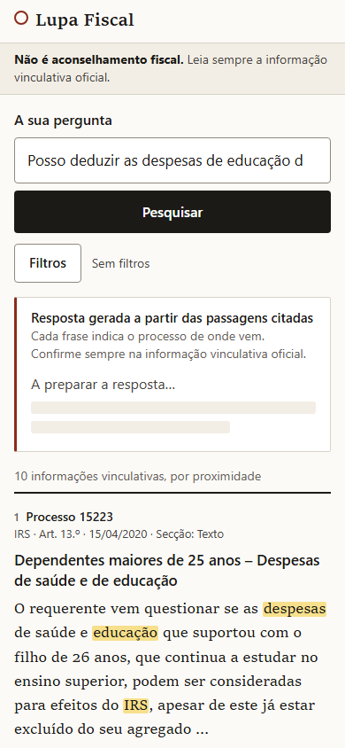
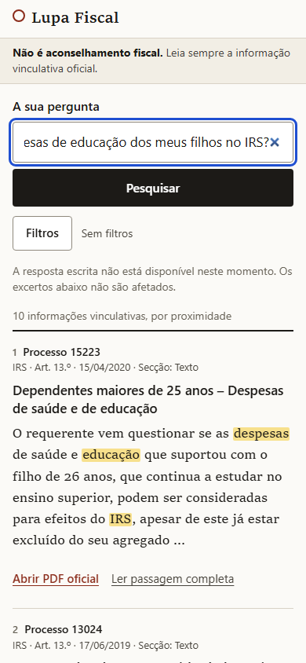
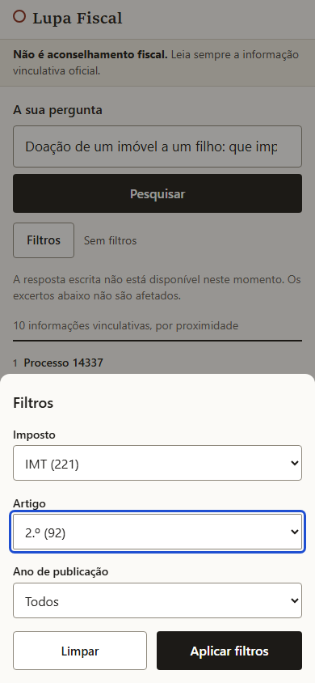

# Lupa Fiscal

**Ask a tax question in plain Portuguese and find the published binding rulings (informações vinculativas) that answer it, with the passage, the citation and a link to the official PDF, plus a short answer written only from those passages, every sentence citing its ruling.**

[](https://github.com/nunomarques97/lupa-fiscal/actions/workflows/ci.yml?query=branch%3Amain) · [MIT licence](LICENSE) · .NET 10 · Runs only on your computer · No account, no key, no cost

> **Independent project.** Lupa Fiscal is not affiliated with, endorsed by or connected to the Autoridade Tributária e Aduaneira or any other public body. It only reads rulings that are already public.
>
> **Not tax advice.** Results are excerpts, and the short answer is a reading aid built from them, to help you find the right ruling. Always read the official ruling in full, and ask a qualified professional about your own situation.


- **Every statement has a source.** Every result is a passage quoted from a published ruling, with its process number, tax, article and date, and a link to the PDF on the official site. The short answer above the results is written only from those passages: each sentence names the rulings it comes from, a sentence without a valid citation is removed, and when nothing is left it says so instead of answering.
- **Every tax.** All 13 libraries of binding rulings on the official site, from IRS and IVA to the extraordinary contributions.
- **Free and open source.** MIT licence. No account, API key or paid service, also for the answers: the language model is free, openly licensed and runs on your computer.
- **Local.** Search and answers run on your own computer. Your questions are never sent anywhere.
- **Measured.** On two fixed sets of everyday questions, a matching ruling is in the first 10 results for 43 of 50 IRS questions and 20 of 24 questions on other taxes ([IRS report](docs/eval/report.md), [other taxes](docs/eval/taxes/report.md)).

Version 0.2 covers every tax with published binding rulings: 5998 listed rulings (5790 distinct documents), as listed on 2 October 2026. The written answers are optional: without the answer model, search works exactly as before.

| Code | Covers | Rulings listed |
|---|---|---|
| CIVA | IVA (value added tax) | 2993 |
| CIRS | IRS (personal income tax) | 1189 |
| CIRC | IRC (corporate income tax) | 859 |
| EBF | Estatuto dos Benefícios Fiscais (tax benefits) | 245 |
| CIMT | IMT (property transfer tax) | 221 |
| SELO | Imposto do Selo (stamp duty) | 200 |
| DSRI | Relações internacionais (tax treaties and cross-border cases) | 120 |
| CIMI | IMI (municipal property tax) | 96 |
| RITI | Regime do IVA nas Transações Intracomunitárias (intra-EU VAT) | 43 |
| CIUC | IUC (vehicle tax) | 21 |
| LGT | Lei Geral Tributária (general tax law) | 6 |
| CESE | Contribuição extraordinária sobre o setor energético | 3 |
| CSB | Contribuição sobre o setor bancário | 2 |

Some rulings are published in two libraries (for example EBF and IRS). When the PDF is byte-identical, it is indexed once and shown under the first of its taxes in the order CIRS, CIRC, DSRI, EBF, CIMI, CIMT, CIUC, SELO, CIVA, RITI, LGT, CESE, CSB, and it can still be found by filtering on any of them.

## Em português

O Lupa Fiscal é uma ferramenta gratuita e de código aberto para pesquisar as informações vinculativas publicadas pela Autoridade Tributária e Aduaneira. Basta escrever a pergunta em linguagem corrente para obter as informações vinculativas mais próximas, com a passagem relevante, o número do processo, o artigo, a data e a ligação para o PDF oficial. Por cima dos excertos, um modelo de linguagem gratuito que corre no seu computador escreve uma resposta curta apenas a partir dessas passagens: cada frase indica o processo de onde vem, uma frase sem fonte válida é retirada e, quando nenhuma resta, a ferramenta diz que não encontrou uma resposta suportada por fontes. A versão 0.2 abrange todos os impostos com informações vinculativas publicadas (IRS, IRC, IVA, IMI, IMT, IUC, Imposto do Selo, Estatuto dos Benefícios Fiscais, Lei Geral Tributária e outros) e funciona inteiramente no seu computador, sem conta nem custos. Não constitui aconselhamento fiscal nem tem qualquer ligação à Autoridade Tributária e Aduaneira: leia sempre a informação vinculativa oficial. As instruções de instalação, abaixo, estão em inglês.

## Screens

<p>
  
  
  
</p>

The interface is in European Portuguese and works on desktop and phone. The results appear as soon as the search ends; the answer follows in its own block above them, which takes tens of seconds on a CPU. A citation link in the answer moves to the cited result in the list, which has the link to the official PDF. The article filter lists only the articles of the chosen tax, because article numbers mean different things in different codes. Every screen state at 1440 and 390 px wide is in [docs/evidence/](docs/evidence/): first visit, loading, results, results across taxes, tax and article filters, no results, error, validation, and the answer states (preparing, answered, citation followed, refused, unavailable, error).

## Quick start

You need Windows 10 or 11, the [.NET SDK 10](https://dotnet.microsoft.com/download), [Node.js](https://nodejs.org/) 22 or 24, an internet connection for the first setup and about 1.5 GB of free disk space for the data (about 700 MB of rulings, a 215 MB index and the 470 MB embedding model), plus room for the .NET and npm packages. The written answers are optional and need 2.6 GB more for the answer model and about 5 GB of free memory while the API runs.

```
git clone https://github.com/nunomarques97/lupa-fiscal.git
cd lupa-fiscal
dotnet run --project src/LupaFiscal.Cli -- crawl --all
dotnet run --project src/LupaFiscal.Cli -- index
dotnet run --project src/LupaFiscal.Cli -- model download --model qwen3-4b
npm --prefix web ci
npm --prefix web run build
dotnet run --project src/LupaFiscal.Api
```

Then open http://localhost:4401 and ask a question. Leave out the `model download --model qwen3-4b` line to run search only.

What to expect:

- `crawl --all` downloads the 5998 listed rulings of the 13 taxes at one request per second, so it takes about 1 hour 50 minutes. You can stop it at any time; running it again resumes where it stopped. To start smaller, `crawl --tax CIRS` downloads only the 1189 IRS rulings in about 20 to 25 minutes.
- `index` first downloads the embedding model (about 470 MB, checked against its SHA-256), then indexes the rulings in about 40 minutes on a CPU (about 5 minutes for CIRS alone). Running it again only processes what changed.
- `model download --model qwen3-4b` downloads the answer model (2.57 GB, every file checked against its SHA-256).
- The API loads the embedding model and the index in about 3 seconds; after that, each search takes about 100 milliseconds. The answer model loads in the background after startup, so search never waits for it. An answer takes about 30 seconds on a CPU that is not busy with other work, and can reach the 90 second limit when it is; the API writes one answer at a time.

The rulings are downloaded once and kept on your computer, in `data/`.

## Commands in detail

Run every command from the repository root. Data goes to `data/` (never committed); use `--data-dir PATH` or the `LUPAFISCAL_DATA_DIR` environment variable to put it elsewhere. `dotnet run --project src/LupaFiscal.Cli -- help` lists every command and option.

**Build and test** (offline, on a small synthetic corpus):

```
dotnet build LupaFiscal.slnx
dotnet test LupaFiscal.slnx
```

**1. Download the rulings** of every tax and check that none is left pending:

```
dotnet run --project src/LupaFiscal.Cli -- crawl --all
dotnet run --project src/LupaFiscal.Cli -- corpus-status --all
```

`--all` takes the 13 taxes one after another through one polite client; use `--tax CODE` (for example `--tax CIVA`) for a single tax. `crawl` options: `--retry-failed`, `--use-cached-listing`, `--interval-seconds N` (at least 1), `--max-retries N`, `--max-downloads N` (over the whole run with `--all`, handy for crawling in batches). `corpus-status` exits 0 only when no listed ruling is pending; add `--list-failed` to see the reasons for failures. `extract --all` (or `--tax CODE`) extracts the text of the cached PDFs again, offline. Scanned PDFs without a text layer are listed and skipped (no OCR; no ruling needed it so far).

**2. Download the models.** The embedding model is needed for search (`index` downloads it on its first run); the answer model is only needed for the written answers:

```
dotnet run --project src/LupaFiscal.Cli -- model download
dotnet run --project src/LupaFiscal.Cli -- model download --model qwen3-4b
```

`--model` also accepts `phi-4-mini` and `eurollm-9b`, the two models measured against it ([docs/research/answer-model.md](docs/research/answer-model.md)); the API uses only `qwen3-4b`.

**3. Build the index** of every crawled tax and check it (running `index` again only processes what changed; `--tax CODE` limits either command to one tax):

```
dotnet run --project src/LupaFiscal.Cli -- index
dotnet run --project src/LupaFiscal.Cli -- index-status
```

**4. Search from the command line:**

```
dotnet run --project src/LupaFiscal.Cli -- search "Posso deduzir as despesas de educação dos meus filhos no IRS?"
```

Options: `--tax CIRS`, `--article 78-D` (only together with `--tax`, since article numbers belong to one code), `--year 2024`, `--limit N` (1 to 50, default 10), `--mode hybrid|keyword|vector` (default hybrid).

**Get a cited answer from the command line** (needs the answer model):

```
dotnet run --project src/LupaFiscal.Cli -- answer "Posso deduzir as despesas de educação dos meus filhos no IRS?"
```

It prints the answer, each sentence followed by its citation ids, the cited rulings with their official PDF, and the timings. Options: `--tax`, `--article` (with `--tax`) and `--year`, as for `search`, and `--model NAME` (default `qwen3-4b`).

**5. Run the web interface:**

```
npm --prefix web ci
npm --prefix web run build
dotnet run --project src/LupaFiscal.Api
```

Open http://localhost:4401. The API listens only on this computer (loopback) and also serves the built interface. Its endpoints:

- `GET /api/search?q=...&tax=&article=&year=&limit=` (q required, at most 500 characters; article only with tax; limit 1 to 50, default 10; invalid input returns a 400 problem response)
- `GET /api/answer?q=...&tax=&article=&year=&limit=` (same parameters and validation as search). Returns `{query, status, sentences[{text, citations}], citations[{id, rulingId, processNumber, tax, article, date, subject, section, passage, sourceUrl}], model, firstTokenMs, tookMs}`, with `status` `answered` or `refused`; 503 when the answer model is absent, still loading or busy with another question. A request that is abandoned stops its generation.
- `GET /api/facets` (rulings per tax, per article within each tax as `{tax, value, count}`, and per publication year)
- `GET /api/health`

To work on the interface with live reload, keep the API running, run `npm --prefix web start` and open http://localhost:4400.

**Measure retrieval quality and speed** (needs the index), on the IRS set and on the set for other taxes:

```
dotnet run --project src/LupaFiscal.Cli -- eval --questions eval/questions.json --out docs/eval/report.md --min-recall 0.85
dotnet run --project src/LupaFiscal.Cli -- eval --questions eval/questions-taxes.json --out docs/eval/taxes/report.md
dotnet run --project src/LupaFiscal.Cli -- bench --questions eval/questions.json --max-ms 1000
```

They print their numbers and change no file. Add `--record` to write them to the report and its history (`--label` and `--note` name an eval iteration).

**Measure the answers** (needs the index and each answer model compared) on an even sample of both question sets:

```
dotnet run --project src/LupaFiscal.Cli -- answer-eval --questions eval/questions.json,eval/questions-taxes.json --sample 12 --model qwen3-4b
```

It prints, per model, the share of the model's sentences with valid citations, the share of answers citing an expected ruling, the refusal rate, time to first token and total time (p50 and p95) and the peak memory. Options: `--sample N` (default 12), `--model NAME[,NAME]` (default `qwen3-4b`), `--record` to write the numbers and transcripts to `docs/research/answer-eval.json` (or to `--out FILE`).

## How it works

```mermaid
flowchart LR
    A["Public listings of 13 taxes and ruling PDFs"] -->|"crawl, 1 request/s"| B["Local cache in data/"]
    B -->|"extract text, merge identical PDFs"| C["Sections: request, facts, legal framework, conclusion"]
    C -->|"chunk"| D["Overlapping passages"]
    D -->|"embed locally"| E[("SQLite: FTS5 keyword index and vectors")]
    Q["Your question"] --> K["Keyword ranking (BM25)"]
    Q --> V["Vector ranking (cosine)"]
    E --> K
    E --> V
    K --> R["Reciprocal rank fusion"]
    V --> R
    R --> API["API on localhost:4401"]
    R -->|"top 4 passages, numbered"| G["Local language model (optional)"]
    G -->|"only sentences with valid citations"| API
    API --> UI["Web interface"]
```



1. A polite crawler reads the public listing of each of the 13 taxes and downloads each ruling PDF once: it reads robots.txt first, makes at most one request per second with a descriptive User-Agent, and keeps everything in a local cache.
2. The text of each PDF is extracted. A PDF published byte for byte in two taxes becomes one ruling that both tax filters find.
3. Each ruling is cleaned of page headers and footers, split into its sections (request, facts, legal framework, conclusion) and then into overlapping passages of at most 512 model tokens.
4. Every passage gets a vector from a multilingual model that runs locally (ONNX Runtime, CPU), and goes into a keyword index (SQLite FTS5).
5. A question is searched both ways: by keywords (BM25) and by meaning (vector similarity). The two rankings are merged with reciprocal rank fusion, keeping the best passage of each ruling.
6. For the written answer, the first 4 passages go to a local language model, each with a number, and the model is told to end every sentence with the numbers of the passages it uses. Code then checks every sentence: one without a citation, or citing a number that was not given, is removed. If no sentence is left, the answer is the fixed text "Não encontrei nas informações vinculativas pesquisadas uma resposta suportada por fontes."

Design decisions, rejected alternatives and trade-offs: [docs/WALKTHROUGH.md](docs/WALKTHROUGH.md).

## Results

| | |
|---|---|
| Rulings indexed | 5790 distinct rulings from 5998 listings in 13 taxes (none skipped; 208 identical PDFs published in two taxes counted once) |
| Passages | 34505 |
| Index size | 215 MB, plus about 700 MB of cached rulings |
| Build time on a CPU | crawl about 1 hour 50 minutes at one request per second, index about 40 minutes |
| Eval sets | 50 plain-Portuguese IRS questions over 29 CIRS articles (197 expected rulings), and 24 questions over 7 other taxes (IVA, IRC, IMT, Imposto do Selo, IMI, EBF, IUC; 90 expected rulings), each frozen before any measurement ([how they were built](eval/README.md)) |

| Search mode | IRS recall@10 | IRS MRR@10 | Other taxes recall@10 | Other taxes MRR@10 |
|---|---|---|---|---|
| Keyword only (BM25) | 0.740 | 0.562 | 0.708 | 0.484 |
| Vector only | 0.860 | 0.595 | 0.833 | 0.598 |
| Hybrid (RRF) | **0.860** | **0.632** | **0.833** | **0.645** |

recall@10 is the share of questions with at least one expected ruling in the first 10 results; MRR@10 rewards finding it near the top. Hybrid search finds a matching ruling for 43 of the 50 IRS questions and 20 of the 24 other questions; the misses are listed in the reports. On the IRS-only index of version 0.1 the IRS set scored 0.900 (MRR@10 0.631); the full index has almost five times as many rulings to rank.

Latency of hybrid search over the 50 IRS questions on the full index, including the question's embedding, on a CPU: **77 ms** median (p50), **120 ms** p95, **131 ms** maximum.

Full reports and method: [docs/eval/report.md](docs/eval/report.md) and [docs/eval/taxes/report.md](docs/eval/taxes/report.md).

Written answers, on 12 questions taken from both sets ([method and transcripts](docs/research/answer-model.md)): every sentence the model wrote had valid citations (27 of 27, so none had to be removed), 6 of the 8 answers that could cite an expected ruling did, none was refused, and usefulness and European Portuguese scored 2.42 and 2.83 out of 3 (read and scored by the developer, not by a tax professional). An answer took 29.5 s at the median and 37.6 s at p95 with the CPU free for it, and up to about 90 s while other heavy jobs shared it.

## FAQ

**Can I trust the written answer?**
Treat it as a reading aid, not as the answer. A generated answer can sound right and still be wrong, so it is held to strict citations. It is written only from the passages shown below it, and every sentence names the rulings it comes from: code removes any sentence without a citation or citing a passage the model was not given, and shows a fixed refusal ("Não encontrei nas informações vinculativas pesquisadas uma resposta suportada por fontes.") when nothing valid is left. This proves where each sentence claims to come from, not that it reads the ruling correctly: in the measured sample, one answer in twelve drew a conclusion its cited ruling does not draw. The real answer captured for the screenshots ([docs/evidence/answer-1440.png](docs/evidence/answer-1440.png)) is wrong in the same way: its first sentence says a child over 25 counts as a dependent, the opposite of article 13, no. 5 b) of the IRS code and of the rulings it cites, which are about a 26-year-old child. Follow the citation and read the ruling before relying on it.

**Why local?**
No server, account or paid service is needed, and your questions stay on your computer. The network is used only to download the rulings from the official site and the models from Hugging Face; searching and answering never leave your machine. The price is speed: an answer takes about 30 seconds on a CPU, so the results are shown first.

**Why hybrid search?**
Keyword search is good at exact legal terms and article numbers; vector search is good at everyday wording. Combined, they rank the right ruling higher than either alone (MRR@10 0.632 against 0.562 and 0.595 on the IRS set, 0.645 against 0.484 and 0.598 on the other taxes).

**Which taxes are covered?**
Every library of binding rulings on the official site: the 13 in the table at the top. Some rulings concern another law than their library's code, such as a State Budget law or a tax treaty; they keep it in their citation.

**Is it tax advice?**
No. It helps you find relevant rulings. A ruling answers the specific situation it was asked about; read it in full and ask a qualified professional about your own case.

## About the rulings

The rulings are published by the Autoridade Tributária e Aduaneira on [info.portaldasfinancas.gov.pt](https://info.portaldasfinancas.gov.pt/). The site's terms allow reproduction for non-commercial purposes with the source cited, and every result names its ruling and links to its official PDF. The site also states that only the version published in Diário da República is authentic. Details: [docs/research/gate0.md](docs/research/gate0.md).

This repository contains no ruling PDFs and no corpus: each user downloads the rulings to their own computer. The only ruling content in it is a few passages and subject lines shown, with their source, in the screenshots and the design mocks (`docs/ui/`), a few listing entries quoted in the tests and the research notes, and the ruling identifiers of the eval set.

## Embedding model

[intfloat/multilingual-e5-small](https://huggingface.co/intfloat/multilingual-e5-small), MIT licence, pinned at revision `614241f622f53c4eeff9890bdc4f31cfecc418b3`. The files used are `onnx/model.onnx` (fp32), `onnx/sentencepiece.bpe.model` and `onnx/tokenizer.json`, downloaded from Hugging Face without an account and verified by SHA-256 before every use. The model is not stored in this repository.

## Answer model

[Qwen3-4B-Instruct-2507](https://huggingface.co/Qwen/Qwen3-4B-Instruct-2507), Apache-2.0 licence, in the int4 ONNX Runtime GenAI build [robinsmits/qwen3-4b-instruct-2507-onnx-int4](https://huggingface.co/robinsmits/qwen3-4b-instruct-2507-onnx-int4), pinned at revision `97d8690faf0cad28279dd10334a67c79f673a57f` (2.57 GB). `model download --model qwen3-4b` downloads its 10 files from Hugging Face without an account into `data/models/qwen3-4b-instruct-2507-int4/`; each is checked by size and SHA-256 before it is kept and again before every load. It runs in process on the CPU with ONNX Runtime GenAI. It was chosen over Phi-4-mini-instruct (MIT) and EuroLLM-9B-Instruct (Apache-2.0) on 12 eval questions: every sentence it wrote carried valid citations (27 of 27), it cited an expected ruling in 6 of the 8 answers where one was among its passages, and it wrote the most useful answers in correct European Portuguese. Comparison, pinned hashes and transcripts: [docs/research/answer-model.md](docs/research/answer-model.md). The model is not stored in this repository.

## Third-party licences

| Component | Use | Licence |
|---|---|---|
| [multilingual-e5-small](https://huggingface.co/intfloat/multilingual-e5-small) | Embedding model | [MIT](https://huggingface.co/intfloat/multilingual-e5-small/blob/main/README.md) |
| [PdfPig](https://github.com/UglyToad/PdfPig) | PDF text extraction | [Apache-2.0](https://github.com/UglyToad/PdfPig/blob/master/LICENSE) |
| [Qwen3-4B-Instruct-2507](https://huggingface.co/Qwen/Qwen3-4B-Instruct-2507) | Answer model (int4 ONNX build by robinsmits) | [Apache-2.0](https://huggingface.co/Qwen/Qwen3-4B-Instruct-2507/blob/main/LICENSE) |
| [ONNX Runtime](https://github.com/microsoft/onnxruntime) | Running the embedding model | [MIT](https://github.com/microsoft/onnxruntime/blob/main/LICENSE) |
| [ONNX Runtime GenAI](https://github.com/microsoft/onnxruntime-genai) | Running the answer model | [MIT](https://github.com/microsoft/onnxruntime-genai/blob/main/LICENSE) |
| [Microsoft.ML.Tokenizers](https://github.com/dotnet/machinelearning) | Model tokeniser | [MIT](https://github.com/dotnet/machinelearning/blob/main/LICENSE) |
| [Microsoft.Data.Sqlite](https://github.com/dotnet/efcore) and [SQLite](https://sqlite.org/) | Index storage and keyword search | [MIT](https://github.com/dotnet/efcore/blob/main/LICENSE.txt), [public domain](https://sqlite.org/copyright.html) |
| [Angular](https://github.com/angular/angular) | Web interface | [MIT](https://github.com/angular/angular/blob/main/LICENSE) |
| [Playwright](https://github.com/microsoft/playwright) | Screenshots (development only) | [Apache-2.0](https://github.com/microsoft/playwright/blob/main/LICENSE) |

The interface uses the fonts already installed on your system; no font files are bundled or downloaded.

## Roadmap

- v0.1: CIRS rulings, local search, no generated answers.
- v0.2 part 1: every tax with binding rulings.
- v0.2 part 2 (this version): short answers written by a local model only from the retrieved passages, every sentence citing its ruling, with a fixed refusal when nothing is supported.
- v1: public hosting.

## Contributing

Issues and pull requests are welcome. See [CONTRIBUTING.md](CONTRIBUTING.md) for setup, tests, the polite-crawling rules and the evidence a change needs.

## Licence

[MIT](LICENSE). The licence covers the code in this repository, not the rulings or the models.
